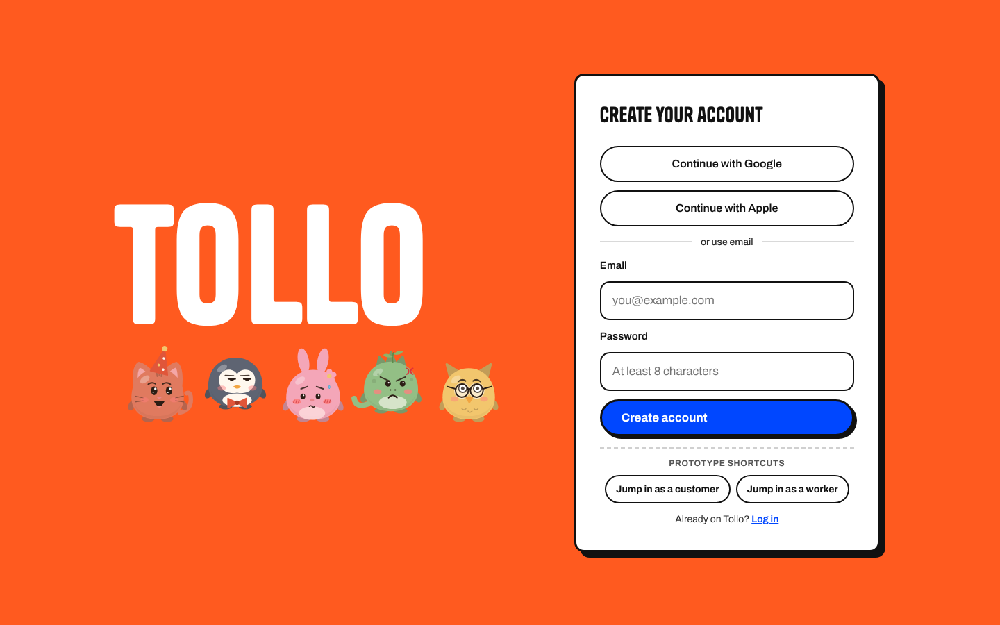

# Tollo

**No experience. Paid by the hour. No pressure.**

> Tollo is a two-sided marketplace for hourly, no-experience physical work in the UK: removals help, event crew and warehouse moves, all in one place, with none of the CV checks or etiquette pressure of hospitality shift apps.




## The idea

Plenty of people want an honest few hours of physical work, and plenty of households and small businesses need an extra pair of hands. The work is currently split between pay-per-task apps, hospitality-heavy shift apps and single-company event agencies. Tollo puts it all in one place:

- **Hourly blocks only**, with a two-hour minimum, so every job is worth turning up for.
- **No experience required.** Each job card says what kit is needed. Trainers often count.
- **Households and businesses** both book from day one.
- **Self-employed workers** set their own minimum rate and opt in to the jobs they want.

## What the prototype does

| For workers | For customers |
| --- | --- |
| Sign up, verify age and run a quick ID check | Post a job: what, when, where and pay per person |
| Build an animated avatar "buddy" | Mark jobs as urgent |
| Browse a job board sorted by pay, distance or start time | Watch local helpers opt in live |
| Set a work radius on a live map and a minimum hourly rate | Message the team before the job |
| Weekly calendar of bookings and an earnings dashboard | Card charged only when the job is finished |

## Run it

There's no build step. Open `index.html` in a browser, or serve the folder:

```sh
python3 -m http.server 8000
# then visit http://localhost:8000
```

Use the **Prototype shortcuts** on the sign-up card to jump straight in as a customer or a worker. Data is stored in your browser's local storage, so it's private to you and resets when you clear site data.

## Built with

- Plain HTML, CSS and JavaScript in single self-contained pages
- Hand-drawn SVG avatars with 10 species, custom colours and moods
- [Leaflet](https://leafletjs.com) and OpenStreetMap for the work-radius map
- Tanker and Archivo typefaces

## Status

Tollo is an early-stage prototype. Sign-in, ID checks and payments are simulated; no real accounts, documents or card details are collected.

## Rights

© Luke Leslie Melville. All rights reserved. No open-source licence is granted.
